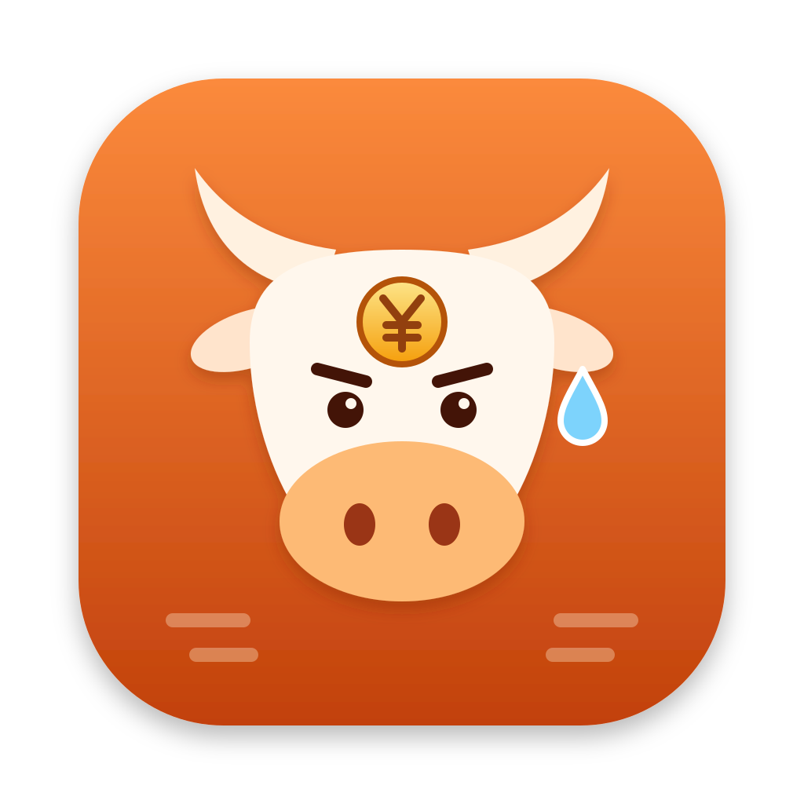
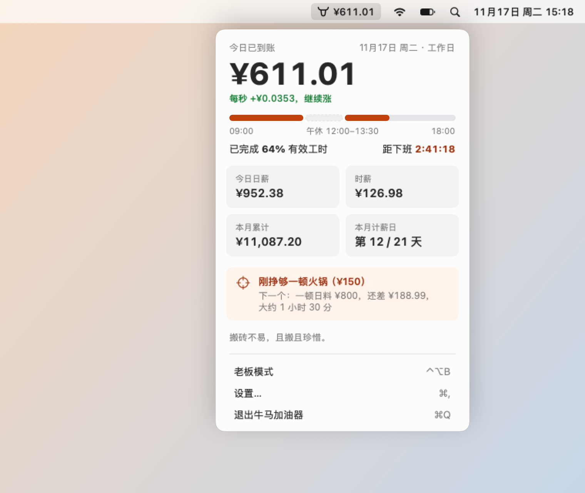
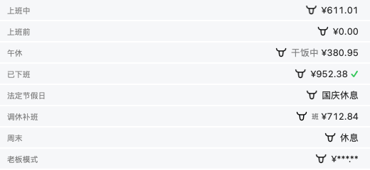
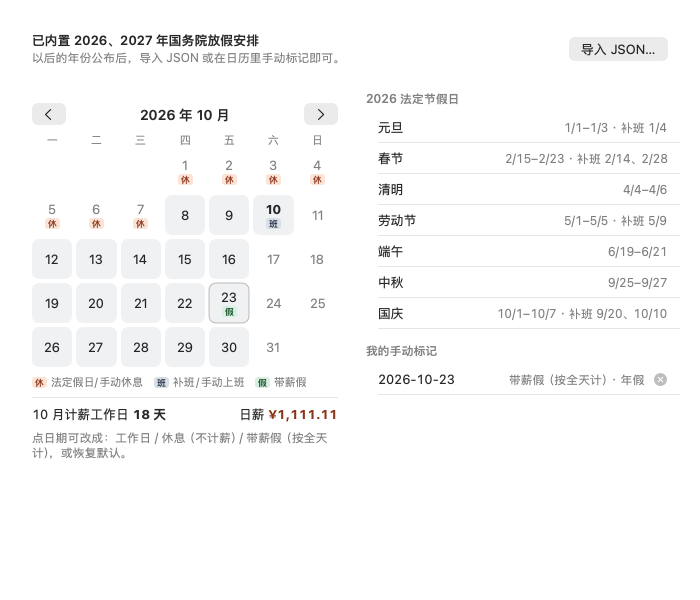

<p align="center">
  
</p>

<h1 align="center">Niuma Booster（牛马加油器）</h1>

<p align="center">
  Every second at work is money in the bank.<br>
  A macOS menu bar app that shows, second by second, how much you've earned today.
</p>

<p align="center">
  <a href="https://github.com/RYKK77/niuma-booster/releases/latest">Download the latest release</a> ·
  macOS 13+ · Universal (Apple silicon / Intel) · Works offline · MIT licensed
</p>

<p align="center">
  <a href="README.md">简体中文</a> · English
</p>

<p align="center">
  
</p>

> "牛马" (literally "ox and horse") is Chinese internet slang for an overworked office worker. The app's interface is in Simplified Chinese, and its holiday data follows the official schedule of mainland China.

## What it does

- **Live earnings in the menu bar**: during working hours the amount ticks up every second. Digits are monospaced, so the menu bar doesn't jitter.
- **Knows where you are in the workday**: shows ¥0.00 before work, pauses at lunch and shows "干饭中" (out to lunch), shows the full day's pay with a check mark after work, and shows "休息" (day off) on weekends and public holidays.
- **Daily rate based on actual working days**: monthly salary ÷ paid working days in the current month, or a fixed 21.75 days if you prefer. Monthly, yearly and hourly pay are all supported.
- **Chinese public holidays and make-up workdays built in**: the State Council schedules for 2026 and 2027 are included. Make-up workdays are paid as normal, and the menu bar marks them with "班".
- **Manual overrides**: mark any day on the calendar as a workday, a day off, or paid leave (paid leave counts as a full day). Later years can be imported as JSON.
- **Drop-down panel**: earned today, earnings per second, countdown to the end of the day, a progress bar of working hours, daily / hourly / month-to-date pay, and which paid day of the month it is.
- **Milestones and pep talks**: get notified when you've earned enough for a bubble tea or a hot-pot dinner. The panel shows a new line of encouragement every hour.
- **Boss mode**: press ⌃⌥B and every amount in the menu bar and panel turns into `¥***.**`. Press it again to bring them back.
- **Flexible schedule**: set your own start, end and lunch times. Overnight shifts and alternating six-day weeks (大小周) are supported.
- **Choose what the menu bar shows**: amount only / amount + progress / amount + countdown / icon only.
- **End-of-day notification and launch at login.** Settings stay on your Mac. Nothing is uploaded.

<p align="center"><br>The menu bar changes with your workday: working, before work, lunch, done for the day, public holiday, make-up workday, weekend, boss mode</p>

<p align="center"><br>Holiday settings: public holidays are built in, click a date to override it</p>

## Install

Download `NiumaBooster-<version>.dmg` from [Releases](https://github.com/RYKK77/niuma-booster/releases), open it, and drag 牛马加油器 into Applications.

The app isn't notarized by Apple, so macOS blocks it the first time you open it:

1. Double-click it once. When the warning appears, click Done.
2. Open System Settings › Privacy & Security, find 牛马加油器 near the bottom, click Open Anyway, and confirm.

Or remove the quarantine flag in Terminal and open it directly:

```bash
xattr -dr com.apple.quarantine "/Applications/牛马加油器.app"
```

## Build from source

Requires Xcode (or the Command Line Tools). Runs on macOS 13 and later, on Apple silicon and Intel.

```bash
./build.sh            # builds build/牛马加油器.app with an ad-hoc signature
./build.sh install    # also copies it to ~/Applications and opens it (required for launch at login)
./build.sh dmg        # also packages build/NiumaBooster-<version>.dmg
swift test            # runs the unit tests for the pay calculations
```

For debugging:

```bash
swift run NiumaBooster --dump "2026-11-17 15:18:42"   # prints the menu bar text and calculations at that moment (default settings)
swift run NiumaBooster --render ./render              # renders the panel and settings pages to PNG offscreen
```

## How pay is calculated

- Daily rate = monthly salary ÷ paid working days in the month (or a fixed 21.75 days). Yearly pay is divided by 12. Hourly pay × effective hours per day.
- Paid working days = regular weekly workdays − public holidays + make-up workdays. Paid leave counts.
- Which rule decides what kind of day it is, highest first: manual mark > imported JSON > built-in State Council schedule > weekly schedule (including alternating six-day weeks).
- Every second the amount is recalculated from the current time rather than accumulated, so it stays correct after sleep, wake, or a clock change.
- An overnight shift (ending earlier in the clock than it starts) belongs to the day it starts.
- On a paid-leave day, the full daily rate is shown.

## Holidays

The State Council holiday schedules for 2026 and 2027 are built in:

- 2026: [国办发明电〔2025〕7号](https://www.news.cn/politics/20251104/88bcffd88ae249e58c699b8772548e3d/c.html)
- 2027: [国办发明电〔2026〕10号](https://www.news.cn/politics/20261105/f90cd6ad4df94ab4833b141e52ccfc13/c.html)

For later years, import a JSON file in Settings › 节假日 (Holidays):

```json
[
  {"date": "2028-01-01", "type": "holiday", "name": "元旦"},
  {"date": "2028-01-02", "type": "workday", "name": "元旦"}
]
```

`type` is `holiday` (day off) or `workday` (make-up workday).

## Code layout

- `Sources/NiumaCore`: pure-Foundation pay engine, holiday data, settings model and menu bar text (unit tested)
- `Sources/NiumaBooster`: AppKit menu bar item (`NSStatusItem` with monospaced digits), SwiftUI panel and settings window, global hotkey, notifications, launch at login
- `Tests/NiumaCoreTests`: the numbers from the design, paid days per month, overnight shifts, manual marks, alternating six-day weeks and more

## License

[MIT](LICENSE): free to use, modify, distribute and use commercially, as long as the copyright notice and license text are kept.
