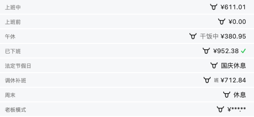
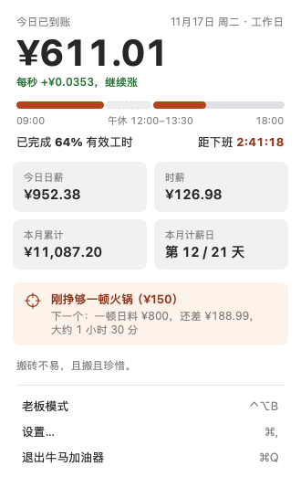
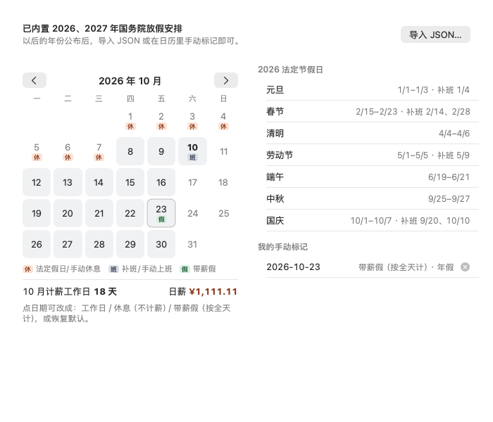

<p align="center">
  
</p>

<h1 align="center">牛马加油器</h1>

<p align="center">
  上班的每一秒都在进账。<br>
  Mac 菜单栏按秒显示「今天已经挣到多少钱」，给打工人一点实实在在的动力。
</p>

<p align="center">
  <a href="https://github.com/RYKK77/niuma-booster/releases/latest">下载最新版</a> ·
  macOS 13+ · Apple 芯片 / Intel 通用 · 不联网
</p>

## 它能做什么

- **菜单栏实时到账**：上班时间里金额每秒往上跳，数字等宽，不会左右抖。
- **自动识别上下班状态**：上班前显示 ¥0.00，午休暂停并显示「干饭中」，下班后显示全天工资并打勾，周末和节假日显示「休息」。
- **日薪按实际工作日算**：月薪 ÷ 当月计薪工作日，也可以选固定 21.75 天；支持月薪、年薪、时薪。
- **内置法定节假日和调休**：已内置 2026、2027 年国务院放假安排，调休补班日照常计薪，菜单栏会加个「班」字提醒。
- **手动标记**：在日历上把某天改成工作日、休息或带薪假（带薪假按全天计）；以后的年份可以导入 JSON。
- **下拉面板**：今日已到账、每秒收入、下班倒计时、工时进度条、日薪 / 时薪 / 本月累计、第几个计薪日。
- **里程碑和加油语录**：挣够一杯奶茶、一顿火锅时提醒你，面板里每小时换一句加油的话。
- **老板模式**：按 ⌃⌥B，菜单栏和面板里的金额全部变成 `¥***.**`，再按一次恢复。
- **作息灵活**：自定义上下班和午休时间，支持跨夜班和大小周。
- **显示随你选**：仅金额 / 金额 + 进度 / 金额 + 下班倒计时 / 仅图标。
- **下班通知、开机自启**，设置只存在本机，不联网、不上传。

<table>
  <tr>
    <td align="center"><br>菜单栏的各种状态</td>
    <td align="center"><br>点开后的面板</td>
  </tr>
</table>

<p align="center"><br>节假日设置：内置法定节假日，点日期就能手动标记</p>

## 下载安装

到 [Releases](https://github.com/RYKK77/niuma-booster/releases) 下载 `NiumaBooster-<版本>.dmg`，打开后把「牛马加油器」拖进「应用程序」。

安装包没有经过 Apple 公证，第一次打开会被系统拦住：

1. 先双击打开一次，看到提示后点「完成」。
2. 打开「系统设置 › 隐私与安全性」，在下方找到牛马加油器，点「仍要打开」，再确认一次。

或者在终端里去掉隔离标记后直接打开：

```bash
xattr -dr com.apple.quarantine "/Applications/牛马加油器.app"
```

## 从源码构建

需要 Xcode（或 Command Line Tools）。支持 macOS 13 及以上，Apple 芯片和 Intel 都能跑。

```bash
./build.sh            # 生成 build/牛马加油器.app，本地 ad-hoc 签名
./build.sh install    # 另外复制到 ~/Applications 并打开（开机自启需要装在这里）
./build.sh dmg        # 另外打成 build/NiumaBooster-<版本>.dmg 安装包
swift test            # 跑计薪逻辑的单元测试
```

调试用：

```bash
swift run NiumaBooster --dump "2026-11-17 15:18:42"   # 打印该时刻的菜单栏文字和计算结果（默认设置）
swift run NiumaBooster --render ./render              # 把面板和设置页离屏渲染成 PNG
```

## 计算规则

- 日薪 = 月薪 ÷ 当月计薪工作日（也可选固定 21.75 天）；年薪按 12 个月折算；时薪 × 每天有效工时。
- 计薪工作日 = 每周工作日 − 法定节假日 + 调休补班日，带薪假照算。
- 判断某天是什么日子的优先级：手动标记 > 导入的 JSON > 内置国务院安排 > 每周作息（含大小周）。
- 每秒按当前时间重新计算，不累加，睡眠唤醒、改系统时间后也准。
- 跨夜班（下班早于上班）算在上班那天。
- 带薪假当天直接显示全天日薪。

## 节假日

内置 2026、2027 年国务院放假安排：

- 2026 年：[国办发明电〔2025〕7号](https://www.news.cn/politics/20251104/88bcffd88ae249e58c699b8772548e3d/c.html)
- 2027 年：[国办发明电〔2026〕10号](https://www.news.cn/politics/20261105/f90cd6ad4df94ab4833b141e52ccfc13/c.html)

以后的年份可以在「设置 › 节假日」导入 JSON，格式：

```json
[
  {"date": "2028-01-01", "type": "holiday", "name": "元旦"},
  {"date": "2028-01-02", "type": "workday", "name": "元旦"}
]
```

`type` 为 `holiday`（放假）或 `workday`（调休上班）。

## 代码结构

- `Sources/NiumaCore`：纯 Foundation 的计薪引擎、节假日数据、设置模型、菜单栏文案（有单测）
- `Sources/NiumaBooster`：AppKit 菜单栏（`NSStatusItem` + 等宽数字）、SwiftUI 面板和设置窗口、全局快捷键、通知、开机自启
- `Tests/NiumaCoreTests`：设计稿上的数字、各月计薪日、跨夜班、手动标记、大小周等
